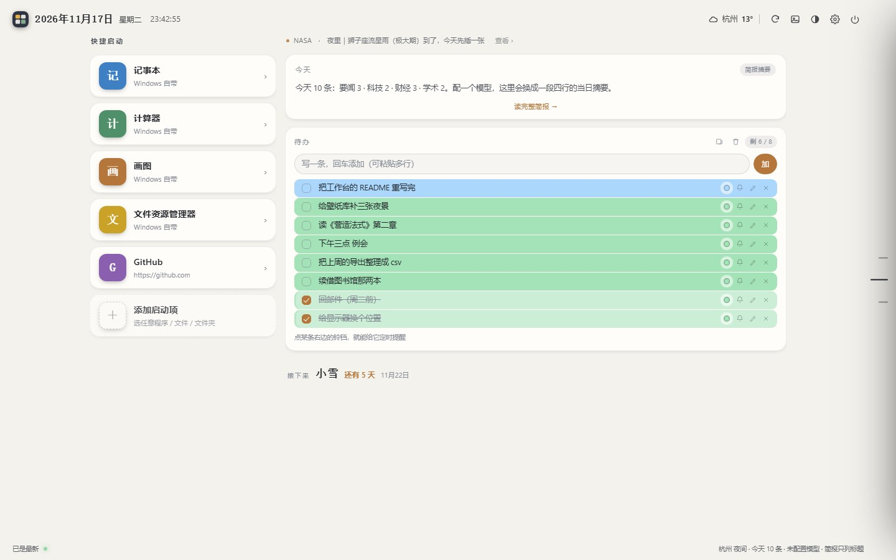
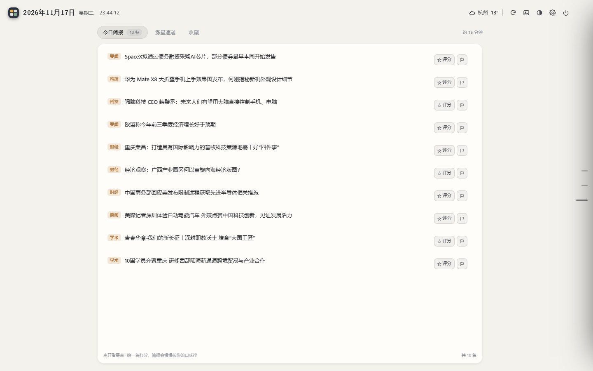

# 工作台（Workbench）

一个跑在本机的桌面首页：**照片铺满全屏当壁纸，下面是今天要读的东西和今天要做的事**。

打开它，先看一张图、读一段这张图的来历，往下滚一屏是待办和快捷启动，
再往右是今天的简报 —— 读完可以打分、收藏，它会慢慢学会你关心什么。

- 单进程本地服务 + 系统浏览器的「应用模式」窗口，**不是** Electron
- **零第三方依赖**，纯 Python 标准库
- 启动路径上没有任何同步网络请求 —— 点开就是秒开，内容后台补
- 所有数据都在本机 `%APPDATA%\Workbench`，没有账号、没有上传

> **平台：仅 Windows 10/11。** 依赖 `os.startfile` / `msvcrt` / `%APPDATA%` 等 Windows 特性。
> **Python：3.10 或更高**（注解里用了 `int | None`）。

---

## 界面

三页，右侧一根竖排短横线是页签，滚轮或方向键翻页。


**风景**：全屏壁纸 + 这张图的引子与科普。按 `N` 换一张，滚轮往下进工作台。
壁纸不是随机轮换，是按「天气 × 时段 × 季节 × 天象事件 × 你的偏好」算分挑的。



**工作台**：左边快捷启动（任意程序 / 文件 / 文件夹 / 网址），右边今日速览、待办、节日倒计时。



**资讯**：今日简报 / 涨星速递 / 收藏 三段。简报每条可打 1–10 分或标「不感兴趣」，
分数会进排序权重；读完想留的，按旗子收藏。

---

## 它做什么

| 区域 | 说明 |
| --- | --- |
| **风景页** | 从 NASA APOD、必应每日图、微软 Spotlight、ESA/Hubble、ESA/Webb、ESO 等免 key 图源取图，也支持你自己的文件夹；按天气时段算分挑一张，并写一段这张图的来历 |
| **今日简报** | 从配置的 RSS 源抓当天资讯，按「要闻 / 财经 / 科技 / 学术」分类，排序后交给大模型挑出当日 N 条并写成要点。点条目进抽屉看简述和原文入口 |
| **评分与排序** | 1–10 分或「不感兴趣」。评分先决定把哪些资讯交给模型（选稿），再决定生成的列表顺序；每天固定留 2 个探索位，不看偏好，防止越用越窄 |
| **涨星速递** | 近期涨星快的开源项目，3–5 条，带一句「它是什么、为什么涨」 |
| **收藏** | 资讯和仓库都能存。跨天保留，和评分互不影响 |
| **待办** | 主窗直接输入，支持多行粘贴、颜色标记、定时提醒；可以开一个置顶小窗放在屏幕角落 |
| **快捷启动** | 任意程序 / 文件 / 文件夹 / 快捷方式 / 网址，内置文件浏览器挑文件，支持改名、排序、删除 |
| **天气与节日** | IP 定位 + Open-Meteo，含日出日落与月相；中国节假日、二十四节气、自定义纪念日倒计时 |

资讯源默认只留「要闻 / 财经 / 科技 / 学术」，娱乐、体育、生活八卦关键词会被硬过滤掉。

---

## 快速开始

### 源码运行

```bash
python app/main.py
```

会自己绑一个 `127.0.0.1` 上的空闲端口（从 39217 起往后找）并用系统浏览器开一个无地址栏的应用窗口。
关掉窗口即整体退出。

命令行参数：

| 参数 | 作用 |
| --- | --- |
| `--no-window` | 只起服务，不自动开窗口 |
| `--port N` | 指定端口 |
| `--prefetch` | 无窗口预生成**当天**简报缓存后退出（给定时任务用，不绑端口、不开窗口） |

### 打包成 exe

```bash
python -m PyInstaller --noconfirm build/Workbench.spec   # 产物在 dist/Workbench/
python build/install.py                                  # 装到 %LOCALAPPDATA%\Programs\Workbench + 建桌面快捷方式
```

`build/Workbench.spec` 里的路径全部按「spec 文件所在目录」推算，仓库放在哪都能打。

---

## 第一次打开

三件事都是空的，这是设计：

1. **壁纸**：启动后十几秒会自己抓第一批（NASA APOD / 必应每日图，都免 key）。
   网络不通就停在「还没有配图」那一屏，点「选个文件夹」指一个本地目录也行。
2. **启动项**：默认空列表。启动项和具体机器强相关，写死的默认值换台电脑就是错的。
   点左边那张「添加启动项」自己挑。
3. **简报**：不配模型也能用，会退化成「只抓标题 + 摘要」的本地骨架。
   配了模型（任何 OpenAI 兼容接口）才有要点和简述。

---

## 配置

### 文件位置

| 内容 | 路径 |
| --- | --- |
| 配置 | `%APPDATA%\Workbench\config.json` |
| 缓存（简报 / 天气 / 配图索引） | `%APPDATA%\Workbench\cache\` |
| 配图库 | `%APPDATA%\Workbench\art\library\` |
| 收藏 | `%APPDATA%\Workbench\bookmarks.json` |
| 评分记录 | `%APPDATA%\Workbench\feedback.jsonl` |
| 浏览器窗口的用户数据 | `%APPDATA%\Workbench\browser\` |
| 日志 | `%APPDATA%\Workbench\workbench.log` |

配置缺字段会自动补默认值，版本升级会自动迁移并落盘。**这个文件不在仓库里**，只在你本机。

### 大模型（可选）

不配模型也能用。想让它写要点和简述，填下面三项即可 —— 任何 OpenAI 兼容接口都行：

```json
{
  "ai": {
    "mode": "api",
    "base_url": "https://api.deepseek.com/v1",
    "api_key": "sk-...",
    "model": "deepseek-chat",
    "web_url": "https://chat.deepseek.com/"
  }
}
```

`web_url` 是「网页版模式」下打开的聊天页（把提示词复制过去手动跑），不用可以留空。

### 资讯源

`news.feeds` 是 RSS 数组，每项 `{name, url, cat}`，`cat` 取「要闻 / 财经 / 科技 / 学术」。
`news.exclude` 是命中即丢弃的关键词黑名单。`news.count` 是每天条数，
`read_minutes` × `chars_per_minute` 决定每条简述的目标字数。

### 配图与壁纸

`photos.dirs` 可以加本地图片目录。NASA APOD、必应每日图、微软 Spotlight、ESA 的几个天文台图源都免 key，默认开着
（NASA 不填 key 会退回 `DEMO_KEY`，每小时只有 30 次配额，所以程序 20 小时才拉一次 APOD）。

图片属性大部分**不用模型就能推**：来源、EXIF 拍摄时间、焦段、曝光时长、文件名里的时间戳，
再加一层中英双语关键词表。EXIF 是手写解析的（一百来行，纯标准库）—— 项目零依赖，
不为了读几个元数据引入 Pillow。

剩下真推不出来的（画面里是什么、视觉天气、色彩氛围）才需要模型：设置里
`photos.vision_tagging` 打开后会把图片发给 `ai.vision_model`。**不配视觉模型就不会发，
自动退回本地推导。**

### 启动项

默认是**空列表**。想预设，可以往 `%APPDATA%\Workbench\config.json` 的 `launchers` 里加：

```json
[
  {"id":"demo","title":"记事本","kind":"file","path":"C:\\Windows\\notepad.exe","accent":"#3f7fc4"},
  {"id":"site","title":"示例站","kind":"url","url":"https://example.com"},
  {"id":"cmd","title":"跑个命令","kind":"shell","command":"echo hi","cwd":"C:\\"}
]
```

### 设置面板是表驱动的

设置里能改的东西，全部定义在 **`app/settings_schema.py` 一个文件**里
（分组、字段、类型、默认值、说明文字）。后端 `GET /api/settings-schema` 把它吐出来，
前端按类型渲染成表单（文本 / 密码 / 整数 / 开关 / 下拉 / 多行列表）。

**加一个配置项只改这一处**（最多再往 `store.DEFAULT_CONFIG` 里加个默认值）。

---

## HTTP 接口

服务只绑 `127.0.0.1`，并且所有 `/api/*`（除 `/api/ping`）都做同源校验，
跨站页面发来的写请求会被 403 挡掉。

| 入口 | 作用 |
| --- | --- |
| `GET /api/ping` | 探活 |
| `GET /api/state` | 读全部状态 |
| `GET /api/prompt` | 取当前提示词 |
| `GET /api/fs` | 文件浏览器（给「添加启动项」用，只读） |
| `GET /api/bookmarks` | 读收藏 |
| `POST /api/refresh` | 重建整份简报 |
| `POST /api/wallpaper` | 只重算壁纸 |
| `POST /api/expand` / `POST /api/expand-all` | 生成单条 / 全部简述 |
| `POST /api/photos` | 扩充配图库（会下载图片） |
| `POST /api/feedback` | 评分（`rate` / `open` / 收藏） |
| `POST /api/launch` | 执行一个启动项 |
| `POST /api/todos` `POST /api/launchers` `POST /api/config` | 写接口 |
| `POST /api/quit` | 退出 |

---

## 隐私说明（重要）

**默认不采集本机痕迹。** 生成简报时会用到四类信息，但前两类必须你亲手打开开关：

| 配置项 | 默认 | 作用 |
| --- | --- | --- |
| `signals.enabled` | `false` | 总开关。关着就**完全不采集**，提示词里也不会出现这段 |
| `signals.browser_history` | `false` | 单独控制要不要读 Edge / Chrome 的 `History`（只读，先复制到临时目录再打开，读完即删） |
| `signals.days` | `14` | 往前追溯多少天 |

打开后读取的是：AI 助手的使用痕迹（没有该目录就跳过）、浏览器最近搜索词与页面标题、
桌面最近动过的文件名。这些内容会压成一段文本，**随提示词一起发送给你在 `ai.base_url`
里配置的模型服务**。全部采集都在本机完成、只读、失败一律降级为空。

其余对外请求只有两类，都可以在代码里查到：
资讯源 RSS（`app/store.py` 的 `DEFAULT_FEEDS`）、图片源与天气（`app/photos.py`、`app/weather.py`）。

---

## 设计要点

几个刻意为之、也是踩过坑才定下来的地方：

**启动路径上不许有慢活。** 开窗口必须立刻返回；清理类工作一律丢后台延迟执行；
找已有实例时「先 bind，绑不上才探端口」（探一个死端口要等几百毫秒超时）。

**请求处理里不许有同步网络 I/O。** `/api/state` 这类高频接口一律只读缓存、
后台异步刷新 —— 宁可给旧一版数据，也不让人干等十几秒。

**抓不到资讯时绝不写空壳进缓存。** 空壳一旦落盘，下次就再也不会重试。
缓存带了「生成日期不是今天就重做」的新鲜度判定。

**防茧房靠配额，不靠权重。** 排序会学你的评分，但每天固定 2 个探索位完全不看偏好，
优先给「没评过的来源」和「今天还没出现过的分类」；同来源 ≤2、同分类 ≤4；
来源权重封顶。权重会被一次情绪化评分带偏，配额不会。

**排序学主题，不学媒体。** 你连着给四家不同媒体的 AI 报道打高分，学到的是
「AI 与资本/安全」这个主题，而不是「财联社好、中新网差」—— 后者正是茧房的形状。

**评分的作用是全链路的三段**，不是只调列表顺序：先按偏好把候选池挑成 50 条交给模型（选稿），
再给生成的 10 条排序，最后每条带一句「为什么排这里」。

**退出不绑在 `pagehide` 上。** 它在页面重载时也会触发，等于按 F5 就静默关掉整个服务。
关窗口靠心跳看门狗，显式退出只有「退出」按钮。

**`while` 循环的终止条件里不能有恒为真的量。** 排序函数里曾因此死循环。

---

## 目录结构

```
app/
  main.py          本地 HTTP 服务 / 路由 / 实例锁 / 心跳看门狗 / 命令行入口
  ai.py            提示词组装、模型调用、简报生成、简述扩写、兜底排序
  rank.py          评分 → 推送权重（分层收缩 + 主题优先 + 配额式探索）
  bookmarks.py     收藏（跨天保留，和评分互不影响）
  store.py         配置与缓存的读写层（原子写 + 线程安全 + 版本迁移）
  settings_schema.py  配置项的唯一真相（设置面板由它渲染）
  photos.py        图源抓取、本地推导打标（EXIF）、按天气时段打分选壁纸、图库索引
  attrs.py         图片属性体系（题材/时段/季节/天气/事件/色彩/构图，中英双语）
  sources.py       本地痕迹采集（默认关闭，见「隐私说明」）
  weather.py       IP 定位 + Open-Meteo + WMO 码映射 + 月相与光照时段
  calendar_cn.py   中国节假日、二十四节气、自定义纪念日倒计时
  todos.py         待办、颜色、提醒
  actions.py       启动项执行、开应用窗口、浏览器缓存治理、窗口存活探测
  logbook.py       分级日志
  web/             前端（原生 JS，无框架、无 CDN）
build/
  Workbench.spec   PyInstaller 打包配置（路径按 spec 位置推算）
  install.py       装到 %LOCALAPPDATA% 并建桌面快捷方式
  make_icon.py     生成多尺寸 .ico
docs/              界面截图
CHANGELOG.md       更新记录（含几个踩过的坑是怎么修的）
selftest.py        同进程自测（见下）
```

---

## 自测

```bash
python selftest.py
```

覆盖配置迁移、日期节气、天气、图片标签、资讯抓取与过滤、提示词组装、
模型 JSON 容错与「编造内容拦截」、排序与防茧房配额、收藏去重、
HTTP 接口与跨站拦截、实例锁、跨天新鲜度、配图库并发、启动路径耗时等。
**未配置模型时会自动跳过联网生成类用例**，所以没有 API key 也能跑。

跑在**你自己的** `%APPDATA%\Workbench` 上（会读写配置和缓存），不会碰其他文件。

卡住的时候：

```bash
WB_DUMP_AFTER=180 python -u selftest.py     # 到点把所有线程栈打出来
```

---

## 已知限制

- 仅 Windows，没有跨平台计划
- 需要系统里装了 Edge 或 Chrome 才能开「应用模式」窗口，否则退回默认浏览器（会有地址栏）
- 浏览器缓存治理的目录清单是 **Edge 专有**的，用 Chrome 时不会生效（也不会报错）
- 图片属性只能推出「时段 / 季节 / 构图 / 长曝」这一层，**画面内容（山 / 海 / 花 / 建筑）
  推不出来** —— 除非配了视觉模型
- PNG 里没有 EXIF（只有 JPEG 有），所以 PNG 的拍摄时间推不出来，只能靠文件名
- 响应式做了 1080 / 900 两档断点，比 900px 更窄时部件会挤（一屏只放一页，通常够用）
- 「涨星速递」是让模型自己检索后写的，**不是**实时抓 GitHub Trending：
  没有可靠数据时它会留空，不做编造

---

## 许可

[MIT](LICENSE)
