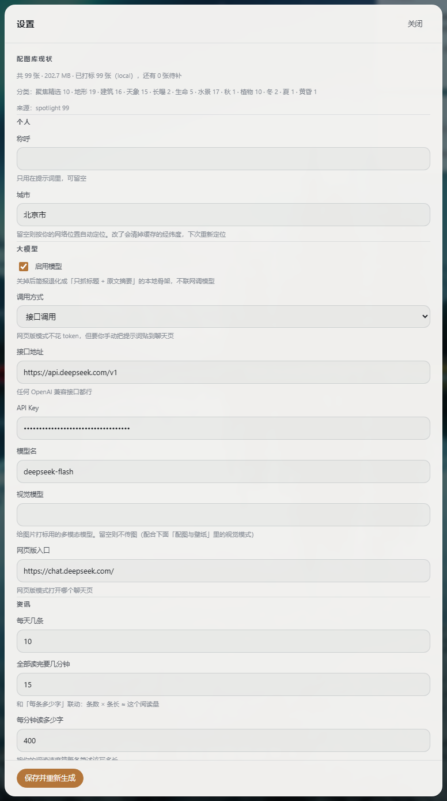

# 工作台（Workbench）

一个跑在本机的桌面信息面板：**照片铺满全屏当壁纸，所有部件是浮在照片上的半透明玻璃面板**。
左边是今天要读的东西，左下是节日倒计时和待办，底部是快捷启动项。

- 单进程本地服务 + 系统浏览器的「应用模式」窗口，**不是** Electron
- **零第三方依赖**，纯 Python 标准库（`pywin32` 可选，只用来建桌面快捷方式）
- 启动路径上没有任何同步网络请求 —— 点开就是秒开，内容后台补

> **平台：仅 Windows 10/11。** 依赖 `os.startfile` / `msvcrt` / `%APPDATA%` 等 Windows 特性。
> **Python：3.10 或更高**（注解里用了 `int | None`）。

---

## 界面


点右上角的齿轮进设置。**所有能调的东西都在这里** —— 字段、分组、每一项的说明，
都由 `app/settings_schema.py` 一张表渲染，不用改代码：



界面结构（都是浮在壁纸上的玻璃面板）：

```
顶栏   [图标] 日期 · 星期 · 节日                    天气 · 刷新 · 换壁纸 · 配色 · 设置 · 退出
左栏   快捷启动（任意程序 / 文件 / 文件夹 / 快捷方式 / 网址）
中间   「每日一句」浮在壁纸中央
右栏   今日简报（点条目进二级页面看要点 → 简述 → 原文）+ 待办
底栏   状态 | 壁纸署名 | 为什么是这张 | 节日倒计时
```

> 上面两张图来自一次**全新安装**：启动项是三个系统自带程序、待办是空的、位置用默认值。

---

## 它做什么

| 区域 | 说明 |
| --- | --- |
| **今日简报** | 从配置的 RSS 源抓当天资讯，按「要闻 / 财经 / 科技 / 学术」分类，交给大模型挑出当日 N 条并写成要点。点条目进二级页面看简述和原文入口 |
| **桌面壁纸** | 从 Bing 每日图、微软 Spotlight、NASA APOD、ESA/Hubble、ESA/Webb、ESO 等图源取图，按「天气 × 时段 × 季节 × 天象事件 × 你的偏好」算分挑一张，并给出选择理由 |
| **天气** | IP 定位取经纬度，走 Open-Meteo；含日出日落、月相、当前光照时段 |
| **节日倒计时** | 中国节假日 + 二十四节气 + 可自定义纪念日 |
| **待办** | 左下可直接输入的轻量待办 |
| **快捷启动项** | 任意程序 / 文件 / 文件夹 / 快捷方式 / 网址，内置文件浏览器挑文件，支持改名、排序、删除 |

资讯源默认只留「要闻 / 财经 / 科技 / 学术」，娱乐、体育、生活八卦关键词会被硬过滤掉。

---

## 快速开始

### 源码运行

```bash
python app/main.py
```

会自己绑一个 127.0.0.1 上的空闲端口（从 39217 起往后找）并用系统浏览器开一个无地址栏的应用窗口。
关掉窗口即整体退出。

命令行参数：

| 参数 | 作用 |
| --- | --- |
| `--no-window` | 只起服务，不自动开窗口 |
| `--port N` | 指定端口 |
| `--prefetch` | 无窗口预生成**当天**简报缓存后退出（给定时任务用，不绑端口、不开窗口） |

### 打包成 exe

```bash
pyinstaller build/Workbench.spec --noconfirm   # 产物在 dist/Workbench/
python build/install.py                        # 装到 %LOCALAPPDATA%\Programs\Workbench + 建桌面快捷方式
```

`build/Workbench.spec` 里的路径全部按「spec 文件所在目录」推算，仓库放在哪都能打。

---

## 配置

### 文件位置

| 内容 | 路径 |
| --- | --- |
| 配置 | `%APPDATA%\Workbench\config.json` |
| 缓存（简报 / 天气 / 配图索引） | `%APPDATA%\Workbench\cache\` |
| 配图库 | `%APPDATA%\Workbench\art\` |
| 浏览器窗口的用户数据 | `%APPDATA%\Workbench\browser\` |
| 日志 | `%APPDATA%\Workbench\workbench.log` |

配置缺字段会自动补默认值，版本升级会自动迁移并落盘。**这个文件不在仓库里**，只在你本机。

### 大模型（可选）

不配模型也能用：简报会退化成「只抓标题 + 摘要」的本地骨架（`generatedBy: "local"`）。
想让它写要点和简述，填下面三项即可 —— 任何 OpenAI 兼容接口都行：

```json
{
  "ai": {
    "mode": "api",
    "base_url": "https://api.deepseek.com/v1",
    "api_key": "sk-...",
    "model": "deepseek-chat",
    "web_url": "https://chat.deepseek.com/"
  }
}
```

`web_url` 是「网页版模式」下打开的聊天页（把提示词复制过去手动跑），不用可以留空。

### 资讯源

`news.feeds` 是 RSS 数组，每项 `{name, url, cat}`，`cat` 取「要闻 / 财经 / 科技 / 学术」。
`news.exclude` 是命中即丢弃的关键词黑名单。`news.count` 是每天条数，
`read_minutes` × `chars_per_minute` 决定每条简述的目标字数。

### 配图与壁纸

`photos.dirs` 可以加本地图片目录。Bing 每日图、微软 Spotlight、NASA APOD、
ESA/Hubble、ESA/Webb、ESO 都**免 key**（NASA 不填 key 会退回 `DEMO_KEY`，
每小时只有 30 次配额，所以程序 20 小时才拉一次 APOD）。
填了 `photos.pexels_key` 会额外走 Pexels 搜索，不填就只用 Spotlight + Bing。

#### 图片属性是怎么来的（本地推导，零成本）

壁纸不是随机轮换，而是按「天气 × 时段 × 季节 × 天象事件 × 你的偏好」算分挑出来的。
算分需要图片属性，这些属性**大部分不用模型就能推出来**：

| 信号 | 推出 | 覆盖的属性层 |
| --- | --- | --- |
| 图片来源 | 天文台 / NASA 的图必然是**天象**（确定性，不是猜）；Pexels 的抓取查询词会写进描述 | 题材 |
| EXIF `DateTimeOriginal` | 拍摄小时 → **时段**；月份 → **季节** | 时段、季节 |
| EXIF `FocalLengthIn35mmFilm` | <24mm → 广角（大场景）；>85mm → 长焦压缩 | 构图 |
| EXIF `ExposureTime` | ≥2 秒 → **长曝** | 事件 |
| 文件名时间戳 | `PXL_20260912_183045` / `IMG_20260912_1830` 这类命名 → 时段 + 季节（EXIF 被聊天软件洗掉时的兜底） | 时段、季节 |
| 标题 / 描述关键词 | 现有的中英双语词表匹配 | 全部 |

**EXIF 是手写解析的**（`app/photos.py` 里一百来行，纯标准库）—— 项目是零依赖的，
不想为了读几个元数据引入 Pillow。解析失败一律当「这张图没有 EXIF」，绝不抛异常。

打标在**启动后 15 秒**于后台跑，只处理还没打过标的条目，所以是增量的、不挡启动。
结果写回索引，下一次选壁纸就用上了。

剩下真推不出来的（画面里到底是山是海是花、视觉天气、色彩氛围）才需要模型 ——
设置里有 `photos.vision_tagging` 开关（**默认关，且本轮尚未接线**，
打开也不会调用模型）。打开后识图更准，但会把图片传给模型、token 消耗可能明显变高。

#### 图库分类

每个条目会有一个 `category`：优先取命中到的**题材**（天象 / 地形 / 植物 / 建筑 / 水景 / 生命 / 人文），
没有题材就按来源兜底（天文图源 / 聚焦精选 / 每日壁纸 / 本人作品）。

- 设置面板里能看到「共多少张 · 多少 MB · 已打标多少张 · 各分类多少张」
- `GET /api/library?category=天象&limit=60` 可以按分类 / 来源筛选分页（只读）

> 图片**物理目录不动**（`art/library/` 是扁平的 sha1 命名）。分类走索引 ——
> 拆物理目录要连带改文件命名、淘汰逻辑、统计、路由，还要迁移已有条目，风险大于收益。

### 启动项

默认是**空列表** —— 启动项和具体机器强相关，首次运行点界面上的「添加启动项」自己挑。
想预设，可以往 `%APPDATA%\Workbench\config.json` 的 `launchers` 里加：

```json
[
  {"id":"demo","title":"记事本","kind":"file","path":"C:\\Windows\\notepad.exe","accent":"#3f7fc4"},
  {"id":"site","title":"示例站","kind":"url","url":"https://example.com"},
  {"id":"cmd","title":"跑个命令","kind":"shell","command":"echo hi","cwd":"C:\\"}
]
```

### 设置面板是表驱动的

设置里能改的东西，全部定义在 **`app/settings_schema.py` 一个文件**里
（分组、字段、类型、默认值、说明文字）。后端 `GET /api/settings-schema` 把它吐出来，
前端按类型渲染成表单（文本 / 密码 / 整数 / 开关 / 下拉 / 多行列表）。

**加一个配置项只改这一处**（最多再往 `store.DEFAULT_CONFIG` 里加个默认值）。
以前字段在 `index.html`、`fillSettings`、`saveSettings` 三处各手写一遍，
加一个要改三个文件，结果漏了一大半 —— 政经加权词、阅读速度、心跳阈值、
窗口尺寸这些全都只能改代码。现在都能在界面上直接调。

配置项包括（不完整）：资讯条数 / 阅读预算 / 每条多少字 / 资讯最多几天前 /
丢弃关键词 / 加权关键词 / 资讯源 / 模型接口与模型名 / 视觉模型 / 网页版入口 /
摄影文件夹 / 配图偏好 / 是否按时段轮换 / 本地打标与视觉打标 /
隐私开关三项 / 0 点预生成 / 心跳超时 / 自动清理浏览器缓存 / 窗口尺寸 / 配色 /
纪念日 / 启动项 JSON。

---

## HTTP 接口

服务只绑 `127.0.0.1`，并且所有 `/api/*`（除 `/api/ping`）都做同源校验，
跨站页面发来的写请求会被 403 挡掉。详见 [`prompts/README.md`](prompts/README.md) 的接口速查表。

| 入口 | 作用 |
| --- | --- |
| `GET /api/ping` | 探活 |
| `GET /api/state` | 读全部状态 |
| `GET /api/prompt` | 取当前提示词 |
| `GET /api/fs` | 文件浏览器（给「添加启动项」用，只读） |
| `POST /api/refresh` | 重建整份简报 |
| `POST /api/wallpaper` | 只重算壁纸 |
| `POST /api/expand` / `POST /api/expand-all` | 生成单条 / 全部简述 |
| `POST /api/photos` | 扩充配图库（会下载图片） |
| `POST /api/launch` | 执行一个启动项 |
| `POST /api/todos` `POST /api/launchers` `POST /api/config` | 写接口 |
| `POST /api/quit` | 退出 |

---

## 自动化

[`prompts/`](prompts/) 里放了两个给 AI 助手或外部调度器用的自包含提示词：

- **每日一刷**（`每日预生成.md`）：每天 0 点后跑 `Workbench.exe --prefetch`，夜里备好当天缓存，早上打开就是新的
- **实时刷新**（`壁纸重算.md`）：应用开着时只重算壁纸，几秒完成

分工原则是：**时间、日期、计算这类本地活归工作台自己；定时、联网的内容生产交给外面的调度器**。

---

## 隐私说明（重要）

生成简报时，程序会**在本机读取**四类信息，用来判断「哪些资讯和这个人有关」：

1. `~/.workbuddy/usage-log.json`、`sessions/*.json`、`traces/*.jsonl` —— AI 助手的使用痕迹（没有这个目录就跳过）
2. Edge / Chrome 的 `History` SQLite —— 最近的**搜索词**和**访问过的页面标题**
3. 桌面上最近动过的文件名
4. 浏览器历史库会被先复制到临时目录再只读打开，读完即删

这些内容会被压成一段文本，**随提示词一起发送给你在 `ai.base_url` 里配置的模型服务**。
全部采集都在本机完成、只读、失败一律降级为空，程序不会把数据发到别处。

**开关在设置面板里**（「本地痕迹与隐私」一组）：

| 配置项 | 默认 | 作用 |
| --- | --- | --- |
| `signals.enabled` | `true` | 总开关。关掉后**完全不采集**，提示词里也不出现这段内容，简报里的「与你相关」一类会变弱 |
| `signals.browser_history` | `true` | 单独控制要不要读浏览器历史（关掉就只留桌面文件与 AI 助手痕迹） |
| `signals.days` | `14` | 往前追溯多少天 |

关掉是**真的不采集**，不是界面上藏起来 —— 代码里 `ai.build_prompt()` 会直接跳过
`sources.collect()` 那一整段。

其余所有对外请求只有两类，都可以在代码里查到：
资讯源 RSS（`app/store.py` 的 `DEFAULT_FEEDS`）、图片源与天气（`app/photos.py`、`app/weather.py`）。

---

## 设计要点

几个刻意为之、也是踩过坑才定下来的地方：

**启动路径上不许有慢活。** 开窗口必须立刻返回；清理类工作一律丢后台延迟执行；
找已有实例时「先 bind，绑不上才探端口」（探一个死端口要等几百毫秒超时）。

**请求处理里不许有同步网络 I/O。** `/api/state`、`/api/prompt` 这类高频接口一律只读缓存、
后台异步刷新 —— 宁可给旧一版数据，也不让人干等十几秒。

**抓不到资讯时绝不写空壳进缓存。** 空壳一旦落盘，下次就再也不会重试。
缓存带了「生成日期不是今天就重做」的新鲜度判定，所以隔夜的预生成结果不会冒充今天的。

**浏览器配置会疯长。** 用 Edge 应用模式开窗会生成用户数据目录（一天能到几百 MB），
所以启动参数禁掉了一堆下载行为，并在后台清扫「一小时没被动过」的缓存。
清理**不在** `open_window` 里做，否则会拖慢启动。

**退出不绑在 `pagehide` 上。** 它在页面重载时也会触发，等于按 F5 就静默关掉整个服务。
关窗口靠心跳看门狗，显式退出只有「退出」按钮。

**`while` 循环的终止条件里不能有恒为真的量。** 排序函数里曾因此死循环，纯 Python 空转握着 GIL，
表现是整个应用卡死。自测里专门有「数据量小于阈值」的用例守着这条。

---

## 目录结构

```
app/
  main.py          本地 HTTP 服务 / 路由 / 实例锁 / 心跳看门狗 / 命令行入口
  ai.py            提示词组装、模型调用、简报生成、简述扩写、兜底排序
  store.py         配置与缓存的读写层（原子写 + 线程安全 + 版本迁移）
  settings_schema.py  配置项的唯一真相（设置面板由它渲染）
  photos.py        图源抓取、本地推导打标（EXIF）、按天气时段打分选壁纸、图库索引与淘汰
  attrs.py         图片属性体系（题材/时段/季节/天气/事件/色彩/构图，中英双语）
  sources.py       本地痕迹采集（浏览器历史 / 桌面文件 / AI 助手用量）
  weather.py       IP 定位 + Open-Meteo + WMO 码映射 + 月相与光照时段
  calendar_cn.py   中国节假日、二十四节气、自定义纪念日倒计时
  actions.py       启动项执行、开应用窗口、浏览器缓存治理、窗口进程存活探测
  web/             前端（原生 JS，无框架、无 CDN）
build/
  Workbench.spec   PyInstaller 打包配置
  install.py       装到 %LOCALAPPDATA% 并建桌面快捷方式
  make_icon.py     生成多尺寸 .ico
prompts/           给自动化用的自包含提示词
docs/              界面截图与打赏码
CHANGELOG.md       更新记录（含几个踩过的坑是怎么修的）
selftest.py        同进程自测（见下）
fixtest.py         单轮修复的专项验证
probe_*.py         排查用的探针（接口可用性 / 数据体检 / 性能剖析）
```

---

## 自测

```bash
python selftest.py
```

覆盖配置迁移、日期节气、天气、图片标签、资讯抓取与过滤、提示词组装、
模型 JSON 容错与「编造内容拦截」、HTTP 接口与跨站拦截、实例锁、跨天新鲜度、
配图库并发、启动路径耗时等。**未配置模型时会自动跳过联网生成类用例**，
所以没有 API key 也能跑。

跑在**你自己的** `%APPDATA%\Workbench` 上（会读写配置和缓存），不会碰其他文件。

卡住的时候：

```bash
WB_DUMP_AFTER=180 python -u selftest.py     # 到点把所有线程栈打出来
```

---

## 已知限制

- 仅 Windows，没有跨平台计划
- 需要系统里装了 Edge 或 Chrome 才能开「应用模式」窗口，否则退回默认浏览器（会有地址栏）
- 浏览器缓存治理的目录清单是 **Edge 专有**的，用 Chrome 时不会生效（也不会报错）
- 图片属性只能推出「时段 / 季节 / 构图 / 长曝」这一层，**画面内容（山 / 海 / 花 / 建筑）
  推不出来** —— 那只靠文件名和来源暗示，推不出的就留空
- PNG 里没有 EXIF（只有 JPEG 有），所以 PNG 的拍摄时间推不出来，只能靠文件名
- `photos.vision_tagging` 开关已就位但**还没接线**，打开也不会调用模型
- 界面有浅色 / 深色 / 纸张三套配色，但响应式只做了 `max-width: 1280px` 一档断点，更窄的屏上部件会挤

---

## 支持这个项目

本项目是由个人热爱驱动的开源项目，如果帮助到了您，可以在您力所能及的范围内对我进行一些打赏，非常感谢各位的支持！

<table>
<tr>
<td align="center"><b>微信赞赏码</b></td>
<td align="center"><b>支付宝</b></td>
</tr>
<tr>
<td></td>
<td></td>
</tr>
</table>

（不打赏也完全没关系 —— 提 issue、指出哪里写得不对，同样是帮忙。）

---

## 许可

[MIT](LICENSE)
